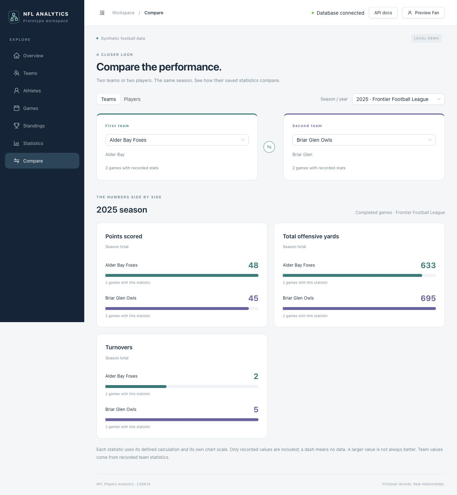

# NFL Players Analytics

A CS5614 sports database prototype built with **React TypeScript + Ant Design**,
**FastAPI + SQLAlchemy**, and **SQLite**. All demo teams, players, and results are
fictional.

## Run locally

Install Git, [uv](https://docs.astral.sh/uv/), and Node.js **22.13+ LTS or 24+**.
`uv` manages Python 3.12.

```sh
git clone https://github.com/g497813927/NFLPlayersAnalytics.git
cd NFLPlayersAnalytics
npm run setup
npm run dev
```

Open **[the app](http://127.0.0.1:5173)** or
**[Swagger API docs](http://127.0.0.1:5173/docs/api)**.
Press `Ctrl+C` to stop both services. Stop existing servers before setup or restart.

Setup installs locked dependencies, creates missing `.env` files, and initializes
and seeds an empty database. It preserves existing configuration and populated
data. For later starts, use only `npm run dev`.

Create your first admin with an interactive prompt; there are **no default passwords**:

```sh
uv run --directory backend --frozen python -m scripts.create_admin
```

## What you can do

- **Explore:** browse teams, players, games, and season standings; filter historical rosters by season.
- **Compare:** view team or player statistics side by side, aggregated from completed games.
- **Follow:** save favorite teams to your account; guests keep browser-local favorites.
- **Watch a demo:** play a clearly labeled simulated drive with key events and low-key contributions.
- **Manage:** admins create users and edit sports records through forms with readable validation.
- **Account:** sign up, sign in/out, and change your password from the account menu.



More screenshots: [player comparison](docs/screenshots/player-comparison.jpg),
[roster filter](docs/screenshots/team-roster-year.jpg),
[admin user creation](docs/screenshots/admin-user-creation.jpg),
[SQL injection rejection](docs/screenshots/sql-injection-rejected.jpg).

## Configure and develop

Edit `backend/.env` for `DATABASE_URL`, account settings, and request-guard flags.
Edit `frontend/.env` for `API_PROXY_TARGET`. Restart the affected service.
Setup copies missing files from `.env.example` and preserves existing values.
Keep secrets out of Git and `VITE_` variables.

Set `SQL_ECHO=true` to print sports SQL in the API terminal. Account queries stay
private. Optional browser inspection requires `APP_ENV=development`,
`SQL_DEBUG_UI=true`, and an admin account.

```sh
npm run check           # Node/Python formatting, lint, type/build and syntax checks
npm run format         # Frontend, Node, and documentation formatting
npm run format:python  # Python formatting
```

The prototype uses manual walkthroughs; there is no automated functional test
suite. The optional request guard complements parameterized SQL. It is not a
production WAF. Real imports, saved comparisons, account recovery, and production
deployment remain future work.

## Documentation

| Guide                                          | Contents                                                                              |
| ---------------------------------------------- | ------------------------------------------------------------------------------------- |
| [Setup and configuration](docs/SETUP.md)       | Full `.env` reference, ports, database initialization, SQL debugging, troubleshooting |
| [User guide](docs/USER_GUIDE.md)               | Accounts, permissions, games, comparisons, season filters, request guard              |
| [Account operations](docs/ACCOUNTS.md)         | Password changes, user creation, sessions, and authorization                          |
| [Database design](docs/DATABASE.md)            | Tables, relationships, constraints, synthetic seed data                               |
| [Project structure](docs/PROJECT_STRUCTURE.md) | Folder map, entry points, and CI jobs                                                 |
| [Agent guidance](AGENTS.md)                    | Repository conventions shared by Codex and Claude                                     |

Source stays in `frontend/` and `backend/`; SQL stays in `db/`; project guides and
screenshots stay in `docs/`. The original `db/schema.sql` submission artifact
is unchanged. `db/auth_schema.sql` adds the two authentication tables.
