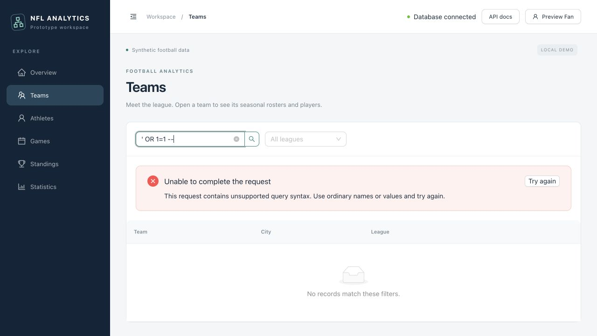

# SQL injection rejection demonstration

Captured on November 10, 2026, against the local prototype with synthetic data
and `WAF_ENABLED=true`. This is an actual browser screenshot of a rejected
request, not a simulated error screen.



## Reproduce through the app

1. Start the configured prototype with `npm run dev`.
2. Open **Teams** and enter `' OR 1=1 --` in **Search team or city**.
3. Submit the search. The API returns HTTP `403` with error code
   `request_blocked`. The page displays: “This request contains unsupported
   query syntax. Use ordinary names or values and try again.”
4. Clear the search and submit again to see the normal team list.

The same read-only request can be inspected in a terminal:

```sh
curl -i --get \
  --data-urlencode "q=' OR 1=1 --" \
  http://127.0.0.1:8000/api/teams
```

```json
{
  "error": {
    "code": "request_blocked",
    "message": "This request contains unsupported query syntax. Use ordinary names or values and try again."
  }
}
```

For this capture, a normal list request reported **20 teams before and after**
the terminal probe. No team records were changed. The empty table beneath the
error is the UI's rejected-search state; it does not mean the database is empty.

## Suggested report caption

The Teams search rejects a SQL injection-style expression before the request
reaches the database route. The application shows a readable explanation rather
than a raw database exception or stack trace. A subsequent normal query confirms
that the 20 synthetic team records remain available.

## What this demonstrates

The request guard recognizes this common probe and returns a controlled error.
It does not execute the supplied text as SQL. Parameterized SQLAlchemy queries
remain the primary SQL injection defense; this pattern filter is an additional
prototype safeguard and is not proof that every possible malicious input will
be detected. Database constraints independently protect relational integrity.

Repeated probes can trigger a temporary HTTP `429` ban. With the default
settings, five strikes within five minutes block that peer for five minutes.
Run the demonstration only against your own local prototype. The limiter is
per process; the README documents proxy and deployment limitations.
