# NFL Players Analytics Final Project Report

Final Project Report

John Zhao · Ishaan Parikh · Victor Prosekov

techzjc@vt.edu · iparikh4@vt.edu · vprosekov@vt.edu

CS5614 Database Management Systems

Dr. Nizamani

Fall 2026

November 11, 2026

Table of Contents

TOC_SLOT

# 1. Introduction to the Mini-verse

## 1.1 Background

Sports analysis depends on relationships among leagues, seasons, teams, players, games, and recorded statistics. A score alone cannot explain who participated, which roster applied at the time, or how the result contributes to a season. NFL Players Analytics models those relationships in a relational database and presents them through a browser application. Although the project name refers to the NFL, the demonstration uses one fictional football league and synthetic people; it is not an official NFL data source.

## 1.2 Motivation

The project supports two main tasks: helping fans discover and compare teams or players, and helping an administrator maintain consistent sports records. Fans can follow teams using account-owned favorites, filter historical rosters, and compare recorded season statistics. Administrators can create users and maintain the shared dataset through forms with named selections, validation, and confirmations. These tasks make database design visible in everyday interactions without requiring users to know SQL or table identifiers.

## 1.3 Overview of the System

This CS5614 prototype combines a React TypeScript interface and Ant Design components with FastAPI, synchronous SQLAlchemy sessions, and SQLite. The final implementation includes role-based accounts, password changes, admin user creation, sports CRUD, a simulated game center, season filters, and two comparison reports. This report explains the 19-table design, setup, security boundaries, and observed application behavior. Evidence was collected on November 11, 2026 in a separate disposable database; the existing development database and the original core schema submission file were preserved.

# 2. User Support

## 2.1 User Roles and Entities

Table 1 distinguishes anonymous browsing from authenticated permissions. Fan and analyst currently share the same access level. Each request derives its user and current role from the database-backed session; hiding an admin menu is not the authorization boundary.

Table 1. Roles and allowed tasks

| Role           | Allowed tasks                                                                                                  |
| -------------- | -------------------------------------------------------------------------------------------------------------- |
| Guest          | Browse games, teams, players, standings, and comparisons. Favorites stay in that browser.                      |
| Fan or analyst | Guest tasks plus account-owned favorite teams and changing their own password.                                 |
| Admin          | Normal-user tasks plus creating users, editing shared sports records, and optional development SQL inspection. |

The app_user table holds identity labels and roles. user_credential stores one Argon2 password hash per credentialed account. auth_session stores hashes of expiring opaque tokens; it never stores the cookie token itself. Seeded users are synthetic profile records without credentials. A role named admin in seed data does not provide a usable login.

## 2.2 Authentication (Login System)

Public signup always creates a fan and does not accept a role. The sign-in form is shared by all roles. Logout removes the current session and clears the cookie. Password change verifies the existing password, writes the new hash and revokes every previous session in one transaction, then issues a new session and CSRF token for the current browser. A concurrent change is detected using the old password hash in the conditional update.

The first administrator is created through the local Python setup command, which prompts for a hidden password. Subsequent admins can create users through Account menu → Create a user. That flow never overwrites an existing email and never switches the administrator into the new account. Figures 1–7 show the user-facing account flows; Table 2 records additional HTTP observations.

Listing 1. Create the first administrator from the repository root

```sh
uv run --directory backend --frozen python -m scripts.create_admin
```

### Account signup

Figure 1 shows the signup form before submission. The password is masked, the form describes normal-user access, and all account details are synthetic. Successful signup opened the signed-in state shown in Figure 3.

Figure 1. Signup form with a masked password before creating Report Fan.

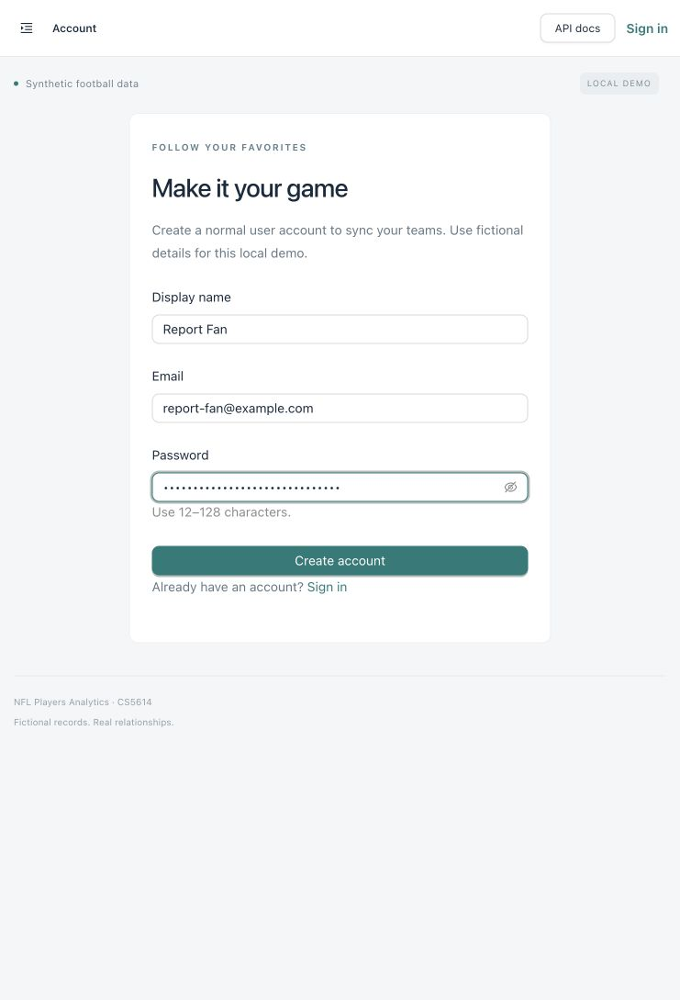

### Account login

Figure 2 shows the login form used for the newly created account. The same screen supports administrators; there is no role selector on public login or signup.

Figure 2. Sign-in form with an existing synthetic account and masked password.

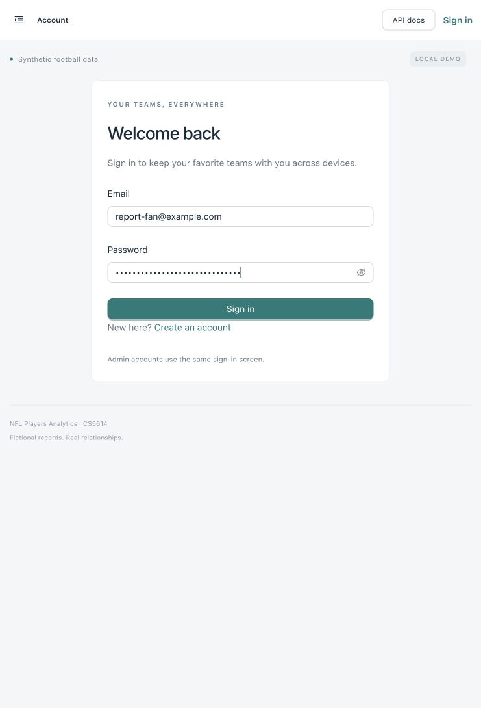

### Account favorites and logout

Figure 3 shows Report Fan signed in with Alder Bay Foxes saved to the account and the Sign out action available. Figure 4 shows the guest state after sign-out. Guest favorites are separate from the account and are never silently imported.

Figure 3. Signed-in identity, account-owned favorite, and Sign out action.

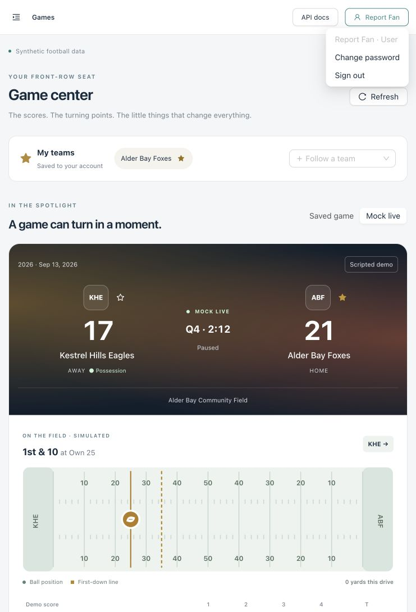

Figure 4. Guest state after sign-out; favorites are browser-local.

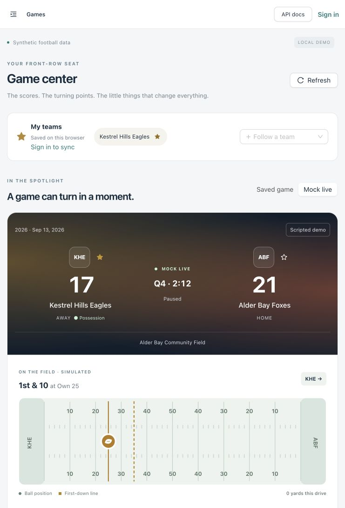

### Changing a password

Figure 5 shows the implemented password-change form. It requires the current password and matching new values of 12–128 characters. This is a form capture, not a screenshot of a completed password change; the successful change and session invalidation were verified through the API as summarized in Table 2.

Figure 5. Password-change form for a signed-in normal user.

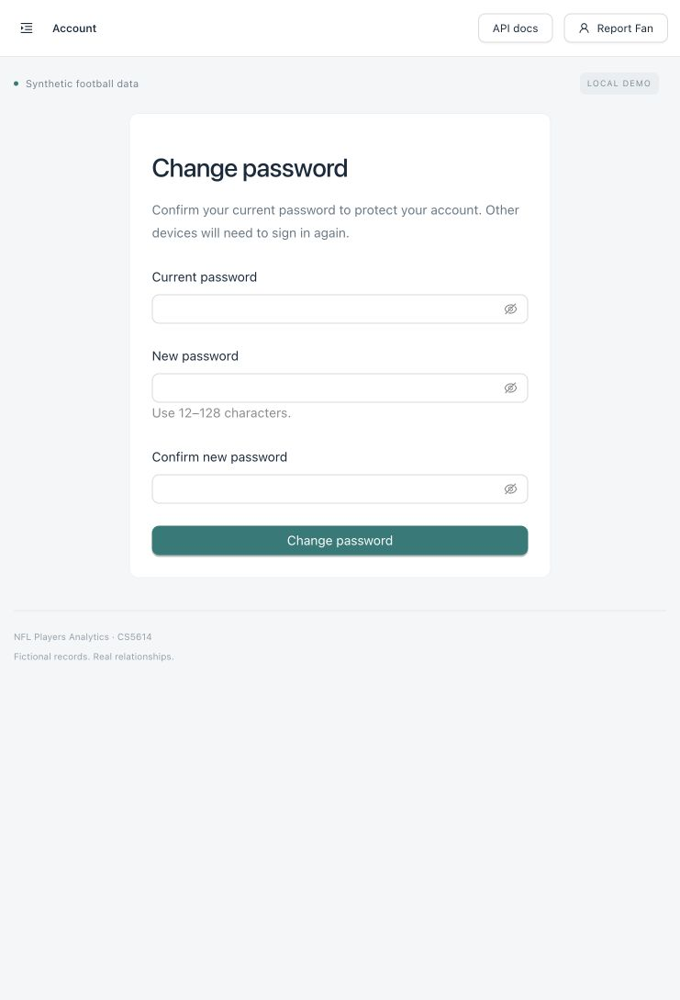

### Administrator user creation

Figure 6 shows the administrator preparing a normal user account. Role options are offered only in this admin flow. The initial password is masked and is hashed before storage.

Figure 6. Admin form before creating the synthetic Report Scout account.

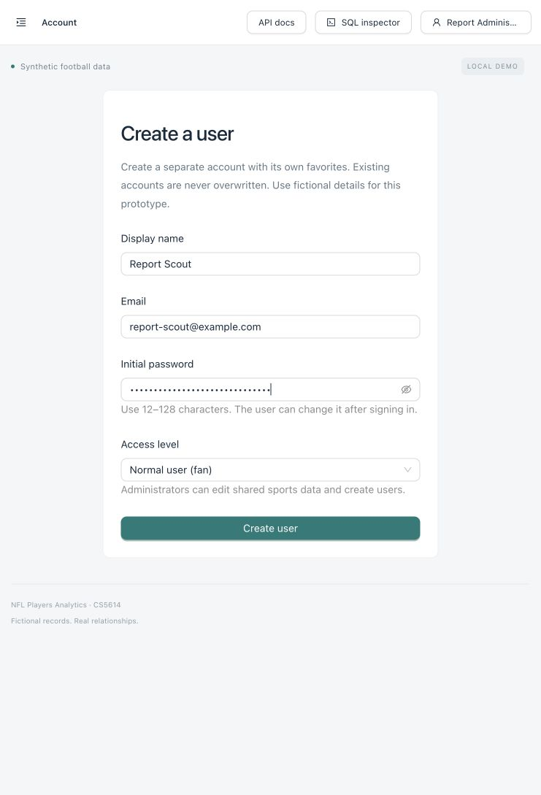

### Administrator creation result

Figure 7 confirms that Report Scout was created and the administrator remained signed in. The form clears its input after success. A repeated email produces a readable conflict instead of replacing the account.

Figure 7. Successful in-app user creation with the admin session preserved.

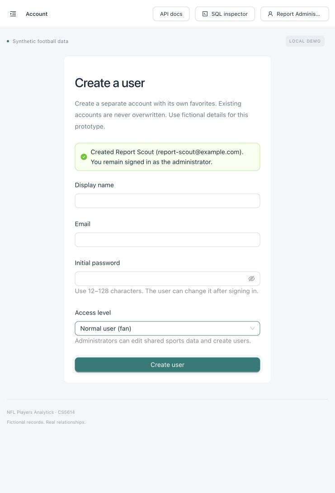

## 2.3 Security Measures

Passwords use Argon2 hashing rather than plaintext or reversible storage. Cookie tokens are random and only their SHA-256 digests are persisted. Cookies are HttpOnly and SameSite=Lax, with a configurable fixed lifetime of 168 hours by default. The local HTTP demo leaves Secure disabled; an HTTPS deployment must enable it. Argon2 and password hashing are consistent with OWASP password-storage guidance [2].

Authenticated writes require a valid session and an X-CSRF-Token header. Account requests also require JSON and reject untrusted browser origins. The server requires admin authorization for shared-data writes and user creation. Favorite ownership comes from the session, never a supplied user ID. Account SQL uses a private engine with logging and request capture disabled, including when sports SQL debugging is enabled.

SQLAlchemy expressions pass values as bound parameters. User input is never concatenated into SQL or accepted as arbitrary SQL through the UI. Database constraints and cross-table validation remain active independently of the optional request guard. This follows the parameterized-query approach described by OWASP [1]. The guard adds signatures for obvious probes, body limits, peer-IP rate limits, and temporary bans; it is not a complete WAF or an installed Fail2ban daemon.

The manual checks in Table 2 were performed against synthetic accounts in the disposable database. They support the listed cases, not an exhaustive security claim. No automated test suite was added.

Table 2. Observed account and security checks

| Action                           | Observed result                                                               |
| -------------------------------- | ----------------------------------------------------------------------------- |
| Wrong current password           | 422; readable “Your current password is incorrect.”                           |
| Password change without CSRF     | 403; asks the user to refresh before saving.                                  |
| Valid password change            | 200; new cookie/CSRF issued; a previous session became anonymous.             |
| Old / new password login         | Old password: 401. New password: 200.                                         |
| Normal user creates a user       | 403; administrator permission is required.                                    |
| Admin creates analyst and fan    | 201; each newly created user could sign in.                                   |
| Existing email                   | 409; account is not overwritten.                                              |
| SQL-like text in password fields | Accepted as a password, including slash-redirect routes; not scanned as SQL.  |
| Terminal SQL enabled             | No tested password, Argon2 hash, or credential-write SQL appeared in the log. |

### SQL injection demonstration

Figure 8 captures a controlled probe in the Teams search box. The request guard returned 403 with an ordinary-language explanation. No table modification was requested or performed. The normal-query route still binds its search value as data; a guard bypass would not turn that bound value into SQL syntax.

Figure 8. The application rejects a quoted boolean probe with a readable message.

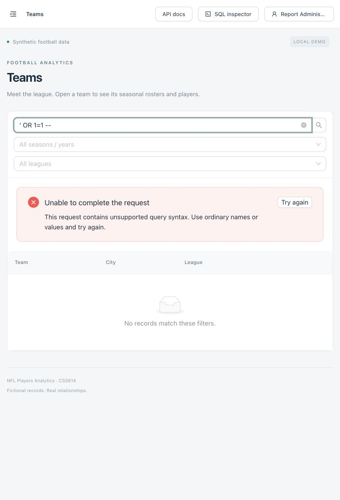

Five detected probes or failed sign-ins within five minutes trigger a temporary block by default. Limits are per process and reset on restart. Vite makes local clients share a loopback peer-IP bucket. These limits can have false positives and do not provide distributed denial-of-service protection.

# 3. Database Connection & Setup

## 3.1 System Connection

Figure 9 follows a request from the browser to SQLite. React forms call the shared API client with JSON; Vite forwards /api, /docs/api, and /openapi.json to FastAPI. FastAPI applies the request guard, authentication, authorization, CSRF checks, and Pydantic validation before service logic executes parameterized SQLAlchemy statements. Successful writes commit; failed writes roll back and return an error envelope with a readable message.

Figure 9. Browser, API, and database connection paths; account queries use private sessions.

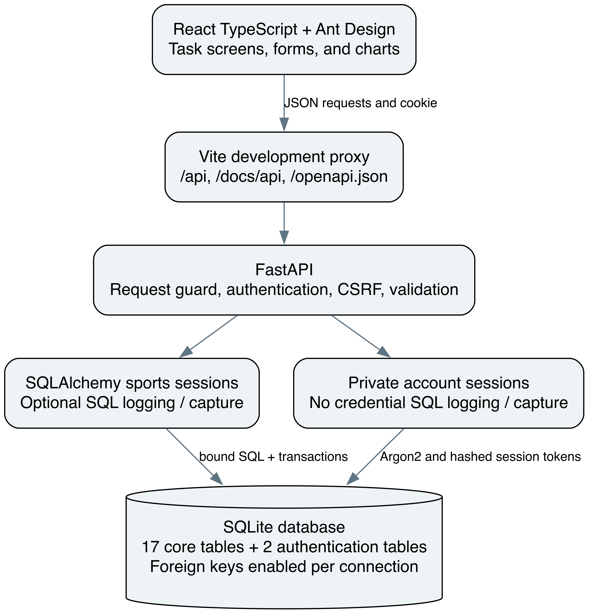

Sports and account engines use the same configured database. Both enable SQLite foreign keys on every connection. SQLite documents that this setting is connection-specific [3]. The browser never opens the database file directly. Source-of-truth records are accessed through the application; the read-only extracts in this report serve only as coursework evidence.

## 3.2 Setup Instructions

Use Git, Node.js 22.13+ LTS or 24+, npm, and uv. Setup installs the locked Python 3.12 environment and locked Node dependencies. Listing 2 is the fresh-clone sequence. Run it from the project root and stop older servers before setup or startup.

Listing 2. Fresh clone, safe setup, and shared development launcher

```sh
git clone https://github.com/g497813927/NFLPlayersAnalytics.git
cd NFLPlayersAnalytics
npm run setup
npm run dev
```

Open http://127.0.0.1:5173 for the interface and /docs/api for Swagger. The launcher starts FastAPI on 8000 and Vite on 5173 in one terminal, labels their output API/Web, and stops both with Ctrl+C or when either process exits. Vite fails on an occupied port instead of silently choosing another. Create the first admin using Listing 1, then use the in-app account menu.

Table 3 lists the main configuration values. Setup copies only missing .env files; shell environment variables override them. Local .env files and database files are ignored by Git. Restart the affected service after changing configuration. Never place credentials in VITE_ variables, which are exposed to the browser.

Table 3. Local configuration and debugging switches

| Setting / file                   | Default and purpose                                                                                      |
| -------------------------------- | -------------------------------------------------------------------------------------------------------- |
| DATABASE_URL / backend/.env      | sqlite:///data/prototype.db; relative paths resolve from backend/.                                       |
| SQL_ECHO / backend/.env          | true in new setup examples; prints actual sports SQL and separate parameters. Fallback if absent: false. |
| SQL_DEBUG_UI / backend/.env      | false; enable only for development/admin request-scoped SQL inspection.                                  |
| SESSION_COOKIE_SECURE            | false for loopback HTTP; enable with HTTPS.                                                              |
| WAF_ENABLED                      | true; parameter binding and permissions still apply when false.                                          |
| API_PROXY_TARGET / frontend/.env | http://127.0.0.1:8000; Vite development proxy target.                                                    |

## 3.3 Database Initialization

Setup initializes and seeds an empty SQLite file, seeds a complete compatible empty schema, and skips populated application data. It rejects partial or unrelated schemas. For a compatible older 17-table database, the only automatic upgrade adds the two authentication tables. Startup itself never creates tables, resets data, or seeds records.

The ORM creation path and standalone SQL path are alternatives. Listing 3 shows the explicit SQL path for a fresh disposable database; it runs both db/schema.sql and db/auth_schema.sql. Using --method orm instead creates the same 19 tables from the imported ORM metadata. The deterministic Python seed program is shared by both paths.

Listing 3. Initialize and seed a fresh database using the SQL scripts

```sh
cd backend
uv run --frozen python -m scripts.init_db --method sql
uv run --frozen python -m scripts.seed
```

## 3.4 Challenges & Lessons Learned

Maintaining both ORM metadata and a submission SQL artifact made path handling and schema parity important. Initialization now resolves schema files independently of the working directory. The original 17-table db/schema.sql remains unchanged for submission; authentication is isolated in db/auth_schema.sql. This keeps a previously submitted artifact stable while making the extension explicit.

Adding accounts introduced a second tension: generated SQL is valuable evidence, but credential queries must never appear in it. A private account engine and request-capture exclusions preserve sports SQL debugging without exposing password hashes or session material. Password changes also require session rotation and a new CSRF token; changing only the stored hash would leave old sessions usable.

Season filters revealed why domain dates matter. A season can end in the following calendar year, so roster, membership, and statistic filters use the stored season relationship rather than extracting a calendar year from each date. Comparison calculations similarly honor each statistic definition instead of summing every value. These choices improved consistency between forms, queries, and charts.

# 4. System Design & Functionality

## 4.1 Schema Design

Table 4 maps the initial relational proposal to the implemented design. The original diagram contains 17 core entities. The final design retains those entities and adds two authentication tables. This update does not modify the core schema file; the new password-change and admin-create-user features reuse the existing authentication extension.

Table 4. Initial proposal to final implementation

| Area                           | Implemented decision and reason                                                                                      |
| ------------------------------ | -------------------------------------------------------------------------------------------------------------------- |
| USER entity                    | Mapped to app_user to avoid a reserved or ambiguous SQL name; keeps email, display name, and role.                   |
| STANDING totals                | Adds ties and derives points as wins + 0.5 × ties. Rank uses win percentage with dense ties.                         |
| Authentication                 | Adds user_credential (one hash per credentialed user) and auth_session (many expiring token digests).                |
| Keys and uniqueness            | Game participants use (game_id, team_id); one home/away role per game and one roster per team/season.                |
| Optional subject/target fields | CHECK constraints require exactly one statistic subject or favorite target, and a valid distinct comparison pair.    |
| Dates and numeric rules        | Valid season/membership date ranges, nonnegative scores and standing counts; jersey numbers remain nullable strings. |
| References                     | Explicit CASCADE, SET NULL, or RESTRICT actions preserve the intended ownership/history behavior.                    |

The design separates entities so descriptive attributes belong to their own keys: a team name is stored on team, a sport name on sport, and a statistic definition on stat_definition. roster resolves the team–season relationship, membership resolves dated athlete–roster participation, and game_participant resolves team–game participation. These separations avoid repeating league names, athlete profiles, and statistic labels in every observation and follow the intended third-normal-form structure. This is a design explanation, not a formal proof of every functional dependency.

standing is an intentional stored summary, recalculated from completed games within the sports-write transaction. Favorite target columns and comparison pair columns preserve the original proposal with explicit CHECK constraints. saved_comparison and data_import have synthetic records but their full save/import workflows remain deferred; the current Compare page is read-only and does not write saved_comparison.

## 4.2 ER Diagram

Figures 10–14 present the final schema as five UML class views. Boxes show entities and their key attributes; Table 5 onward gives every column. Arrows run from the referenced parent to the referencing child. Association labels give parent multiplicity : child multiplicity; 1 is mandatory, 0..1 optional, and 0..* permits many. Repeated boxes are the same entity across views. Brackets beside FK fields mark optional references.

Figure 10 shows that each league belongs to one sport, each team and season to one league, and each roster to one team and one season. Membership belongs to one roster and one athlete. A parent can exist before its child rows, so parent participation is generally partial. The unique team/season roster key prevents duplicate rosters.

Figure 10. Final UML view: sports, leagues, teams, seasons, rosters, and memberships.

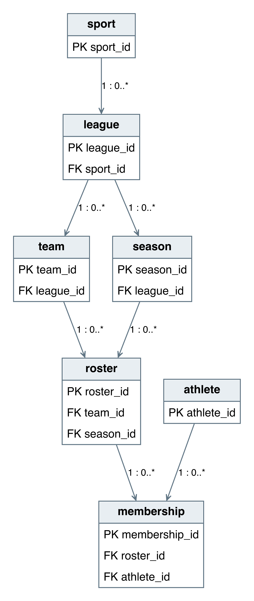

### Game and statistic relationships

Figure 11 connects games to seasons, optional venues, participants, and performance rows. Each statistic belongs to one game and definition, with exactly one athlete or team subject. The database permits zero or more participant rows structurally; application validation saves exactly one home and one away participant with each game and requires both scores for completed games. An athlete statistic also requires a qualifying membership on a participating team on the game date.

Figure 11. Final UML view: games, participants, statistics, definitions, and derived standings.

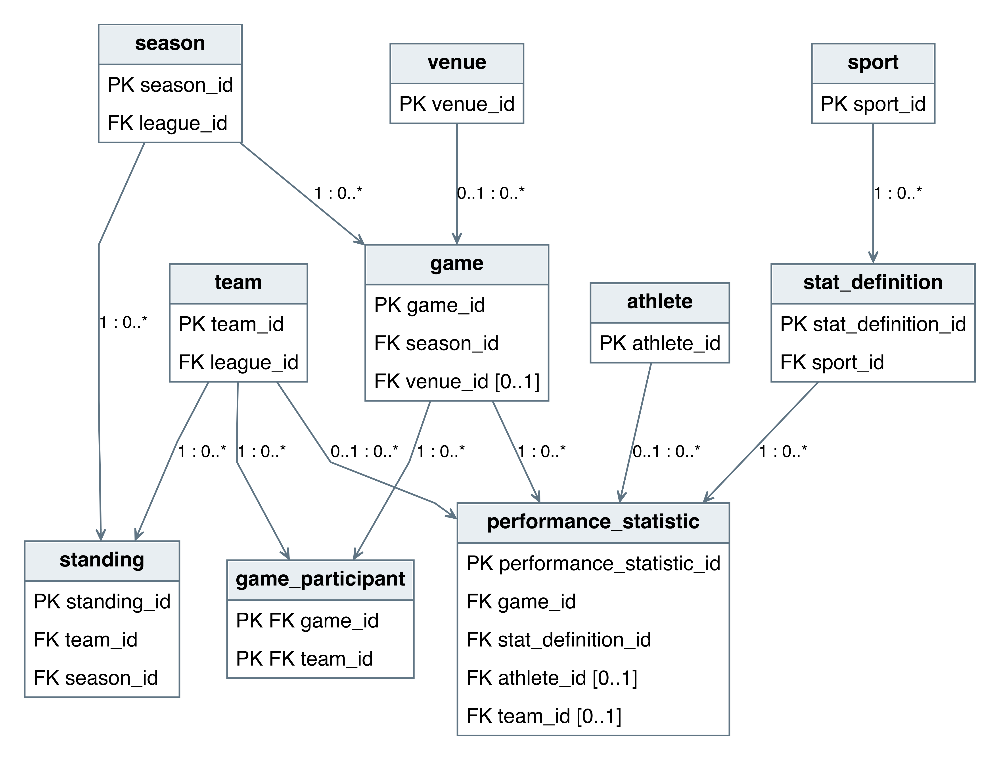

### Account relationships

Figure 12 separates user profiles from credentials. A synthetic or not-yet-credentialed app_user may have no credential; a credential has exactly one user. An auth_session must reference a credential and is deleted with it. data_import can retain a record after its optional initiating user is removed because that FK uses SET NULL.

Figure 12. Final UML view: profiles, credentials, sessions, and import audit records.

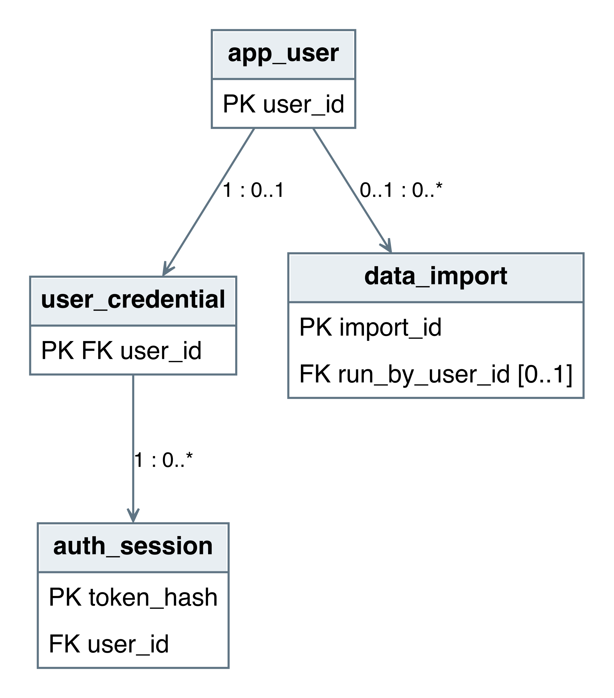

### Favorite ownership

Figure 13 shows mandatory favorite ownership and optional target references. A CHECK constraint permits exactly one target among sport, league, team, and athlete. The current account API exposes team favorites only, derives the owner from the session, and enforces uniqueness per user/target. Removing an owner or target cascades its associated favorite rows.

Figure 13. Final UML view: favorite ownership and alternative target associations.

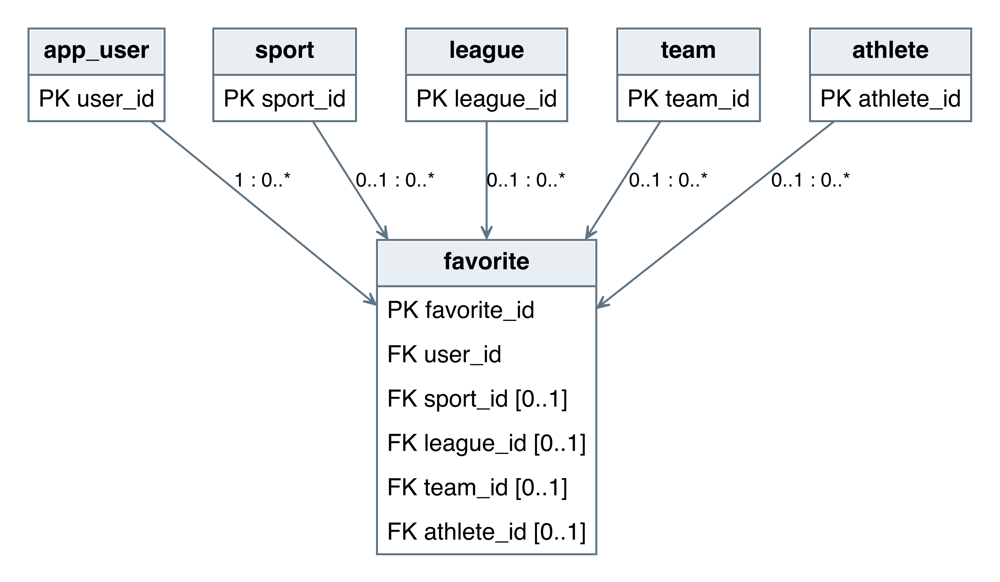

### Stored comparison design

Figure 14 documents the retained saved_comparison entity. Each record has one user and one sport. For object_type team, both distinct team IDs are required and athlete IDs must be NULL; athlete comparisons use the opposite rule. A and B are two independent associations with the same multiplicities. The implemented comparison reports read recorded performance data directly; account-backed saving remains future work.

Figure 14. Final UML view: saved comparison pairs, retained for a later save workflow.

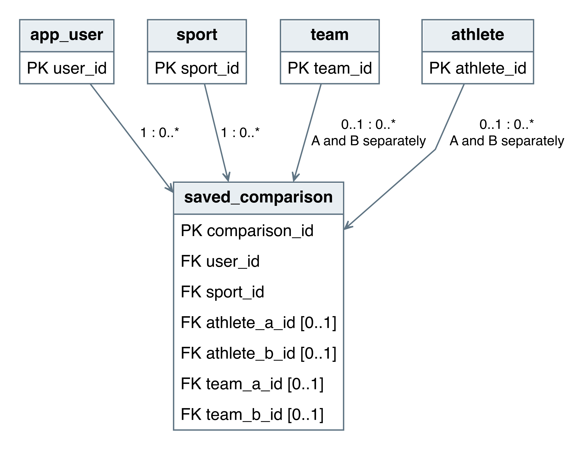

## 4.3 Tables & Keys

Tables 5–23 describe all 19 entities and every mapped column. PK denotes a primary key, FK a foreign key, and NULL an optional value. All integer references match their integer parent keys. FK notes include the delete action. Named constraints and full SQLite DDL are retained in db/schema.sql and db/auth_schema.sql; ORM metadata is exposed through backend/app/models.py.

### sport

Table 5 describes sport. Names the supported sport.

Table 5. sport entity and key dictionary

| Column     | SQL type     | Keys, nullability, and references |
| ---------- | ------------ | --------------------------------- |
| sport_id   | INTEGER      | PK; NOT NULL                      |
| sport_name | VARCHAR(100) | NOT NULL                          |

Unique combinations: sport_name.

Checks: length(trim(sport_name)) > 0.

### league

Table 6 describes league. Groups teams and seasons under one sport.

Table 6. league entity and key dictionary

| Column      | SQL type     | Keys, nullability, and references              |
| ----------- | ------------ | ---------------------------------------------- |
| league_id   | INTEGER      | PK; NOT NULL                                   |
| league_name | VARCHAR(150) | NOT NULL                                       |
| country     | VARCHAR(100) | NOT NULL                                       |
| sport_id    | INTEGER      | NOT NULL; FK → sport.sport_id; DELETE RESTRICT |

Unique combinations: sport_id, league_name.

Checks: length(trim(league_name)) > 0 AND length(trim(country)) > 0.

### team

Table 7 describes team. Stores a fictional team identity and city.

Table 7. team entity and key dictionary

| Column    | SQL type     | Keys, nullability, and references                |
| --------- | ------------ | ------------------------------------------------ |
| team_id   | INTEGER      | PK; NOT NULL                                     |
| team_name | VARCHAR(150) | NOT NULL                                         |
| city      | VARCHAR(100) | NOT NULL                                         |
| league_id | INTEGER      | NOT NULL; FK → league.league_id; DELETE RESTRICT |

Unique combinations: league_id, team_name.

Checks: length(trim(team_name)) > 0 AND length(trim(city)) > 0.

### season

Table 8 describes season. Defines the date interval and league for a season.

Table 8. season entity and key dictionary

| Column      | SQL type     | Keys, nullability, and references                |
| ----------- | ------------ | ------------------------------------------------ |
| season_id   | INTEGER      | PK; NOT NULL                                     |
| season_name | VARCHAR(100) | NOT NULL                                         |
| start_date  | DATE         | NOT NULL                                         |
| end_date    | DATE         | NOT NULL                                         |
| league_id   | INTEGER      | NOT NULL; FK → league.league_id; DELETE RESTRICT |

Unique combinations: league_id, season_name.

Checks: end_date >= start_date; length(trim(season_name)) > 0.

### venue

Table 9 describes venue. Stores a named location for scheduled games.

Table 9. venue entity and key dictionary

| Column     | SQL type     | Keys, nullability, and references |
| ---------- | ------------ | --------------------------------- |
| venue_id   | INTEGER      | PK; NOT NULL                      |
| venue_name | VARCHAR(150) | NOT NULL                          |
| city       | VARCHAR(100) | NOT NULL                          |

Checks: length(trim(venue_name)) > 0 AND length(trim(city)) > 0.

### athlete

Table 10 describes athlete. Stores a synthetic athlete profile.

Table 10. athlete entity and key dictionary

| Column      | SQL type     | Keys, nullability, and references |
| ----------- | ------------ | --------------------------------- |
| athlete_id  | INTEGER      | PK; NOT NULL                      |
| first_name  | VARCHAR(100) | NOT NULL                          |
| last_name   | VARCHAR(100) | NOT NULL                          |
| nationality | VARCHAR(100) | NULL                              |

Checks: length(trim(first_name)) > 0 AND length(trim(last_name)) > 0.

### roster

Table 11 describes roster. Connects one team to one season.

Table 11. roster entity and key dictionary

| Column    | SQL type | Keys, nullability, and references                |
| --------- | -------- | ------------------------------------------------ |
| roster_id | INTEGER  | PK; NOT NULL                                     |
| team_id   | INTEGER  | NOT NULL; FK → team.team_id; DELETE RESTRICT     |
| season_id | INTEGER  | NOT NULL; FK → season.season_id; DELETE RESTRICT |

Unique combinations: team_id, season_id.

### membership

Table 12 describes membership. Records dated athlete participation on a roster.

Table 12. membership entity and key dictionary

| Column        | SQL type    | Keys, nullability, and references                  |
| ------------- | ----------- | -------------------------------------------------- |
| membership_id | INTEGER     | PK; NOT NULL                                       |
| roster_id     | INTEGER     | NOT NULL; FK → roster.roster_id; DELETE CASCADE    |
| athlete_id    | INTEGER     | NOT NULL; FK → athlete.athlete_id; DELETE RESTRICT |
| position      | VARCHAR(40) | NOT NULL                                           |
| jersey_number | VARCHAR(10) | NULL                                               |
| start_date    | DATE        | NOT NULL                                           |
| end_date      | DATE        | NULL                                               |

Unique combinations: roster_id, athlete_id, start_date.

Checks: end_date IS NULL OR end_date >= start_date; length(trim(position)) > 0.

### game

Table 13 describes game. Stores the schedule/status and links to season and optional venue.

Table 13. game entity and key dictionary

| Column    | SQL type    | Keys, nullability, and references                |
| --------- | ----------- | ------------------------------------------------ |
| game_id   | INTEGER     | PK; NOT NULL                                     |
| game_time | DATETIME    | NOT NULL                                         |
| status    | VARCHAR(20) | NOT NULL; Default scheduled                      |
| season_id | INTEGER     | NOT NULL; FK → season.season_id; DELETE RESTRICT |
| venue_id  | INTEGER     | NULL; FK → venue.venue_id; DELETE SET NULL       |

Checks: status IN ('scheduled', 'in_progress', 'completed', 'cancelled').

### game_participant

Table 14 describes game_participant. Stores a home or away team and optional score for a game.

Table 14. game_participant entity and key dictionary

| Column           | SQL type    | Keys, nullability, and references                |
| ---------------- | ----------- | ------------------------------------------------ |
| game_id          | INTEGER     | PK; NOT NULL; FK → game.game_id; DELETE CASCADE  |
| team_id          | INTEGER     | PK; NOT NULL; FK → team.team_id; DELETE RESTRICT |
| participant_role | VARCHAR(10) | NOT NULL                                         |
| score            | INTEGER     | NULL                                             |

Unique combinations: game_id, participant_role.

Checks: score IS NULL OR score >= 0; participant_role IN ('home', 'away').

### stat_definition

Table 15 describes stat_definition. Defines a sport-specific metric and its aggregation rule.

Table 15. stat_definition entity and key dictionary

| Column             | SQL type     | Keys, nullability, and references              |
| ------------------ | ------------ | ---------------------------------------------- |
| stat_definition_id | INTEGER      | PK; NOT NULL                                   |
| stat_name          | VARCHAR(100) | NOT NULL                                       |
| abbreviation       | VARCHAR(20)  | NOT NULL                                       |
| calc_type          | VARCHAR(20)  | NOT NULL                                       |
| sport_id           | INTEGER      | NOT NULL; FK → sport.sport_id; DELETE RESTRICT |

Unique combinations: sport_id, abbreviation.

Checks: length(trim(stat_name)) > 0 AND length(trim(abbreviation)) > 0; calc_type IN ('sum', 'average', 'min', 'max', 'last').

### performance_statistic

Table 16 describes performance_statistic. Stores one metric for exactly one athlete or team in a game.

Table 16. performance_statistic entity and key dictionary

| Column                   | SQL type | Keys, nullability, and references                                  |
| ------------------------ | -------- | ------------------------------------------------------------------ |
| performance_statistic_id | INTEGER  | PK; NOT NULL                                                       |
| game_id                  | INTEGER  | NOT NULL; FK → game.game_id; DELETE CASCADE                        |
| stat_definition_id       | INTEGER  | NOT NULL; FK → stat_definition.stat_definition_id; DELETE RESTRICT |
| athlete_id               | INTEGER  | NULL; FK → athlete.athlete_id; DELETE RESTRICT                     |
| team_id                  | INTEGER  | NULL; FK → team.team_id; DELETE RESTRICT                           |
| stat_value               | FLOAT    | NOT NULL                                                           |

Unique combinations: game_id, stat_definition_id, team_id; game_id, stat_definition_id, athlete_id.

Checks: Exactly one of athlete_id or team_id is non-NULL.

### standing

Table 17 describes standing. Stores the recalculated team/season summary.

Table 17. standing entity and key dictionary

| Column      | SQL type | Keys, nullability, and references               |
| ----------- | -------- | ----------------------------------------------- |
| standing_id | INTEGER  | PK; NOT NULL                                    |
| team_id     | INTEGER  | NOT NULL; FK → team.team_id; DELETE CASCADE     |
| season_id   | INTEGER  | NOT NULL; FK → season.season_id; DELETE CASCADE |
| rank        | INTEGER  | NOT NULL                                        |
| wins        | INTEGER  | NOT NULL; Default 0                             |
| losses      | INTEGER  | NOT NULL; Default 0                             |
| ties        | INTEGER  | NOT NULL; Default 0                             |
| points      | FLOAT    | NOT NULL; Default 0                             |

Unique combinations: team_id, season_id.

Checks: rank > 0; points >= 0; wins >= 0 AND losses >= 0 AND ties >= 0.

### app_user

Table 18 describes app_user. Stores display identity, email, and role.

Table 18. app_user entity and key dictionary

| Column       | SQL type     | Keys, nullability, and references |
| ------------ | ------------ | --------------------------------- |
| user_id      | INTEGER      | PK; NOT NULL                      |
| email        | VARCHAR(254) | NOT NULL                          |
| display_name | VARCHAR(100) | NOT NULL                          |
| role         | VARCHAR(20)  | NOT NULL; Default fan             |

Unique combinations: email.

Checks: role IN ('fan', 'analyst', 'admin'); length(trim(email)) > 0 AND length(trim(display_name)) > 0.

### favorite

Table 19 describes favorite. Stores an account-owned favorite with exactly one target.

Table 19. favorite entity and key dictionary

| Column      | SQL type | Keys, nullability, and references               |
| ----------- | -------- | ----------------------------------------------- |
| favorite_id | INTEGER  | PK; NOT NULL                                    |
| user_id     | INTEGER  | NOT NULL; FK → app_user.user_id; DELETE CASCADE |
| sport_id    | INTEGER  | NULL; FK → sport.sport_id; DELETE CASCADE       |
| league_id   | INTEGER  | NULL; FK → league.league_id; DELETE CASCADE     |
| team_id     | INTEGER  | NULL; FK → team.team_id; DELETE CASCADE         |
| athlete_id  | INTEGER  | NULL; FK → athlete.athlete_id; DELETE CASCADE   |
| created_at  | DATETIME | NOT NULL; Default CURRENT_TIMESTAMP             |

Unique combinations: user_id, team_id; user_id, league_id; user_id, sport_id; user_id, athlete_id.

Checks: Exactly one target is non-NULL.

### saved_comparison

Table 20 describes saved_comparison. Retains a valid pair for the proposed future save feature.

Table 20. saved_comparison entity and key dictionary

| Column        | SQL type     | Keys, nullability, and references               |
| ------------- | ------------ | ----------------------------------------------- |
| comparison_id | INTEGER      | PK; NOT NULL                                    |
| user_id       | INTEGER      | NOT NULL; FK → app_user.user_id; DELETE CASCADE |
| sport_id      | INTEGER      | NOT NULL; FK → sport.sport_id; DELETE CASCADE   |
| object_type   | VARCHAR(20)  | NOT NULL                                        |
| athlete_a_id  | INTEGER      | NULL; FK → athlete.athlete_id; DELETE CASCADE   |
| athlete_b_id  | INTEGER      | NULL; FK → athlete.athlete_id; DELETE CASCADE   |
| team_a_id     | INTEGER      | NULL; FK → team.team_id; DELETE CASCADE         |
| team_b_id     | INTEGER      | NULL; FK → team.team_id; DELETE CASCADE         |
| title         | VARCHAR(200) | NOT NULL                                        |
| created_at    | DATETIME     | NOT NULL; Default CURRENT_TIMESTAMP             |

Checks: Exactly one distinct same-kind pair; title is nonblank.

### data_import

Table 21 describes data_import. Retains synthetic import provenance; live importing is deferred.

Table 21. data_import entity and key dictionary

| Column         | SQL type     | Keys, nullability, and references            |
| -------------- | ------------ | -------------------------------------------- |
| import_id      | INTEGER      | PK; NOT NULL                                 |
| source_name    | VARCHAR(200) | NOT NULL                                     |
| imported_at    | DATETIME     | NOT NULL; Default CURRENT_TIMESTAMP          |
| status         | VARCHAR(20)  | NOT NULL; Default pending                    |
| run_by_user_id | INTEGER      | NULL; FK → app_user.user_id; DELETE SET NULL |

Checks: length(trim(source_name)) > 0; status IN ('completed', 'failed', 'pending').

### user_credential

Table 22 describes user_credential. Stores the private password hash for a user.

Table 22. user_credential entity and key dictionary

| Column        | SQL type     | Keys, nullability, and references                   |
| ------------- | ------------ | --------------------------------------------------- |
| user_id       | INTEGER      | PK; NOT NULL; FK → app_user.user_id; DELETE CASCADE |
| password_hash | VARCHAR(255) | NOT NULL                                            |
| created_at    | DATETIME     | NOT NULL; Default CURRENT_TIMESTAMP                 |

### auth_session

Table 23 describes auth_session. Stores a private expiring token digest for a credentialed user.

Table 23. auth_session entity and key dictionary

| Column     | SQL type    | Keys, nullability, and references                      |
| ---------- | ----------- | ------------------------------------------------------ |
| token_hash | VARCHAR(64) | PK; NOT NULL                                           |
| user_id    | INTEGER     | NOT NULL; FK → user_credential.user_id; DELETE CASCADE |
| expires_at | DATETIME    | NOT NULL                                               |
| created_at | DATETIME    | NOT NULL; Default CURRENT_TIMESTAMP                    |

## 4.4 Sample Data and Application Queries

The seed program uses fixed random seed 5614, fictional team/city/name lists, and deterministic schedules for 2022–2026. It creates 20 teams, 100 athletes, 100 games, and 1,260 performance rows. Additional synthetic credentialed users were created through the CLI and application. Report fixture setup also inserted four sport/league pairs through the existing SQLAlchemy models in the disposable database; catalog_fixtures.json records those inputs. They have no game data and do not change the normal football seed. Table 24 records the evidence counts. Authentication activity can change session counts after the snapshot; the sample is not a production export.

Table 24. Evidence snapshot row counts

| Table           | Rows | Table                 | Rows |
| --------------- | ---- | --------------------- | ---- |
| sport           | 5    | league                | 5    |
| team            | 20   | season                | 5    |
| venue           | 10   | athlete               | 100  |
| roster          | 100  | membership            | 500  |
| game            | 100  | game_participant      | 200  |
| stat_definition | 6    | performance_statistic | 1260 |
| standing        | 100  | app_user              | 10   |
| favorite        | 21   | saved_comparison      | 20   |
| data_import     | 5    | user_credential       | 5    |
| auth_session    | 7    | —                     | —    |

The following tables show five actual rows from every entity, with selected fields for readability. The normal seed uses one football league; the extra report-only catalog rows demonstrate that the schema can represent other sports. They are setup fixtures, not evidence of additional supported game visualizations. Password and token hashes are withheld, and no usable credentials are included.

Sample queries are shown in Listings 4–6. They illustrate the application’s parameterized SELECT behavior; the report does not require users to run SQL. League/team names and roster descriptions appear in the GUI instead of raw identifiers. The report’s one-time read-only sample extraction is separate from end-user workflows.

Listing 4. Read teams with a name filter and league label

```sql
SELECT t.team_name, t.city, l.league_name
FROM team AS t JOIN league AS l ON l.league_id = t.league_id
WHERE t.team_name LIKE :search
ORDER BY t.team_name;
-- Bound parameter: search = '%Alder%'
-- Result: Alder Bay Foxes | Alder Bay | Frontier Football League
```

Listing 5. Read a team roster for the selected stored season

```sql
SELECT a.first_name, a.last_name, m.position, m.jersey_number
FROM membership AS m
JOIN athlete AS a ON a.athlete_id = m.athlete_id
JOIN roster AS r ON r.roster_id = m.roster_id
WHERE r.team_id = :team_id AND r.season_id = :season_id
ORDER BY a.last_name, a.first_name;
-- Bound parameters: team_id = 1, season_id = 4 (2025)
```

### sport sample

Table 25 shows five rows from sport; total snapshot rows: 5.

Table 25. sport sample rows (selected fields)

| sport_id | sport_name           |
| -------- | -------------------- |
| 1        | American Football    |
| 2        | Basketball           |
| 3        | Association Football |
| 4        | Baseball             |
| 5        | Ice Hockey           |

### league sample

Table 26 shows five rows from league; total snapshot rows: 5.

Table 26. league sample rows (selected fields)

| league_id | league_name                    | country       | sport_id |
| --------- | ------------------------------ | ------------- | -------- |
| 1         | Frontier Football League       | United States | 1        |
| 2         | Cedar Valley Basketball League | United States | 2        |
| 3         | Harbor District Soccer League  | United States | 3        |
| 4         | Meadow County Baseball League  | United States | 4        |
| 5         | Northlake Hockey League        | United States | 5        |

### team sample

Table 27 shows five rows from team; total snapshot rows: 20.

Table 27. team sample rows (selected fields)

| team_id | team_name           | city        | league_id |
| ------- | ------------------- | ----------- | --------- |
| 1       | Alder Bay Foxes     | Alder Bay   | 1         |
| 2       | Briar Glen Owls     | Briar Glen  | 1         |
| 3       | Cedar Reach Bears   | Cedar Reach | 1         |
| 4       | Dawn Harbor Falcons | Dawn Harbor | 1         |
| 5       | Elm Ridge Stags     | Elm Ridge   | 1         |

### season sample

Table 28 shows five rows from season; total snapshot rows: 5.

Table 28. season sample rows (selected fields)

| season_id | season_name | start_date | end_date   | league_id |
| --------- | ----------- | ---------- | ---------- | --------- |
| 1         | 2022        | 2022-08-01 | 2023-02-28 | 1         |
| 2         | 2023        | 2023-08-01 | 2024-02-28 | 1         |
| 3         | 2024        | 2024-08-01 | 2025-02-28 | 1         |
| 4         | 2025        | 2025-08-01 | 2026-02-28 | 1         |
| 5         | 2026        | 2026-08-01 | 2027-02-28 | 1         |

### venue sample

Table 29 shows five rows from venue; total snapshot rows: 10.

Table 29. venue sample rows (selected fields)

| venue_id | venue_name                   | city         |
| -------- | ---------------------------- | ------------ |
| 1        | Alder Bay Community Field    | Alder Bay    |
| 2        | Cedar Reach Community Field  | Cedar Reach  |
| 3        | Elm Ridge Community Field    | Elm Ridge    |
| 4        | Granite Cove Community Field | Granite Cove |
| 5        | Iron Meadow Community Field  | Iron Meadow  |

### athlete sample

Table 30 shows five rows from athlete; total snapshot rows: 100.

Table 30. athlete sample rows (selected fields)

| athlete_id | first_name | last_name | nationality   |
| ---------- | ---------- | --------- | ------------- |
| 1          | Alden      | Ashford   | United States |
| 2          | Alden      | Brookvale | United States |
| 3          | Alden      | Crestwood | United States |
| 4          | Alden      | Dunridge  | United States |
| 5          | Alden      | Evermere  | United States |

### roster sample

Table 31 shows five rows from roster; total snapshot rows: 100.

Table 31. roster sample rows (selected fields)

| roster_id | team_id | season_id |
| --------- | ------- | --------- |
| 1         | 1       | 1         |
| 2         | 2       | 1         |
| 3         | 3       | 1         |
| 4         | 4       | 1         |
| 5         | 5       | 1         |

### membership sample

Table 32 shows five rows from membership; total snapshot rows: 500.

Table 32. membership sample rows (selected fields)

| membership_id | roster_id | athlete_id | position | jersey_number | start_date |
| ------------- | --------- | ---------- | -------- | ------------- | ---------- |
| 1             | 1         | 1          | QB       | 12            | 2022-08-01 |
| 2             | 1         | 2          | RB       | 24            | 2022-08-01 |
| 3             | 1         | 3          | WR       | 81            | 2022-08-01 |
| 4             | 1         | 4          | LB       | 54            | 2022-08-01 |
| 5             | 1         | 5          | DB       | 31            | 2022-08-01 |

The complete sample_rows.json also includes end_date. The string jersey_number preserves values such as 00.

### game sample

Table 33 shows five rows from game; total snapshot rows: 100.

Table 33. game sample rows (selected fields)

| game_id | game_time            | status    | season_id | venue_id |
| ------- | -------------------- | --------- | --------- | -------- |
| 1       | 2022-09-13; 17:00:00 | completed | 1         | 1        |
| 2       | 2022-09-13; 17:00:00 | completed | 1         | 1        |
| 3       | 2022-09-13; 17:00:00 | completed | 1         | 2        |
| 4       | 2022-09-13; 17:00:00 | completed | 1         | 2        |
| 5       | 2022-09-13; 17:00:00 | completed | 1         | 3        |

### game_participant sample

Table 34 shows five rows from game_participant; total snapshot rows: 200.

Table 34. game_participant sample rows (selected fields)

| game_id | team_id | participant_role | score |
| ------- | ------- | ---------------- | ----- |
| 1       | 1       | home             | 14    |
| 1       | 11      | away             | 17    |
| 2       | 2       | home             | 21    |
| 2       | 12      | away             | 14    |
| 3       | 3       | home             | 14    |

### stat_definition sample

Table 35 shows five rows from stat_definition; total snapshot rows: 6.

Table 35. stat_definition sample rows (selected fields)

| stat_definition_id | stat_name             | abbreviation | calc_type | sport_id |
| ------------------ | --------------------- | ------------ | --------- | -------- |
| 1                  | Points scored         | PTS          | sum       | 1        |
| 2                  | Total offensive yards | YDS          | sum       | 1        |
| 3                  | Turnovers             | TO           | sum       | 1        |
| 4                  | Passing yards         | PASS_YDS     | sum       | 1        |
| 5                  | Rushing yards         | RUSH_YDS     | sum       | 1        |

### performance_statistic sample

Table 36 shows five rows from performance_statistic; total snapshot rows: 1260.

Table 36. performance_statistic sample rows (selected fields)

| performance_statistic_id | game_id | stat_definition_id | athlete_id | team_id | stat_value |
| ------------------------ | ------- | ------------------ | ---------- | ------- | ---------- |
| 1                        | 1       | 1                  | NULL       | 1       | 14.0       |
| 2                        | 1       | 2                  | NULL       | 1       | 442.0      |
| 3                        | 1       | 3                  | NULL       | 1       | 0.0        |
| 4                        | 1       | 4                  | 1          | NULL    | 252.0      |
| 5                        | 1       | 5                  | 2          | NULL    | 190.0      |

### standing sample

Table 37 shows five rows from standing; total snapshot rows: 100.

Table 37. standing sample rows (selected fields)

| standing_id | team_id | season_id | rank | wins | losses | ties | points |
| ----------- | ------- | --------- | ---- | ---- | ------ | ---- | ------ |
| 1           | 1       | 1         | 3    | 1    | 1      | 0    | 1.0    |
| 2           | 2       | 1         | 3    | 1    | 1      | 0    | 1.0    |
| 3           | 3       | 1         | 4    | 0    | 1      | 1    | 0.5    |
| 4           | 4       | 1         | 4    | 0    | 1      | 1    | 0.5    |
| 5           | 5       | 1         | 3    | 1    | 1      | 0    | 1.0    |

### app_user sample

Table 38 shows five rows from app_user; total snapshot rows: 10.

Table 38. app_user sample rows (selected fields)

| user_id | email                           | display_name    | role    |
| ------- | ------------------------------- | --------------- | ------- |
| 1       | demo.fan@example.invalid        | Demo Fan        | fan     |
| 2       | rowan.analyst@example.invalid   | Rowan Analyst   | analyst |
| 3       | avery.manager@example.invalid   | Avery Manager   | admin   |
| 4       | morgan.scout@example.invalid    | Morgan Scout    | analyst |
| 5       | casey.supporter@example.invalid | Casey Supporter | fan     |

### favorite sample

Table 39 shows five rows from favorite; total snapshot rows: 21.

Table 39. favorite sample rows (selected fields)

| favorite_id | user_id | sport_id | league_id | team_id | athlete_id |
| ----------- | ------- | -------- | --------- | ------- | ---------- |
| 1           | 1       | 1        | NULL      | NULL    | NULL       |
| 2           | 1       | NULL     | 1         | NULL    | NULL       |
| 3           | 1       | NULL     | NULL      | 1       | NULL       |
| 4           | 1       | NULL     | NULL      | NULL    | 1          |
| 5           | 2       | 1        | NULL      | NULL    | NULL       |

### saved_comparison sample

Table 40 shows five rows from saved_comparison; total snapshot rows: 20.

Table 40. saved_comparison sample rows (selected fields)

| comparison_id | user_id | object_type | athlete_a_id | athlete_b_id | team_a_id | team_b_id |
| ------------- | ------- | ----------- | ------------ | ------------ | --------- | --------- |
| 1             | 1       | team        | NULL         | NULL         | 1         | 11        |
| 2             | 1       | athlete     | 1            | 51           | NULL      | NULL      |
| 3             | 1       | team        | NULL         | NULL         | 6         | 16        |
| 4             | 1       | athlete     | 26           | 76           | NULL      | NULL      |
| 5             | 2       | team        | NULL         | NULL         | 2         | 12        |

The complete sample also includes sport_id, title, and created_at. These seed rows do not imply an implemented save-comparison screen.

### data_import sample

Table 41 shows five rows from data_import; total snapshot rows: 5.

Table 41. data_import sample rows (selected fields)

| import_id | source_name            | status    | run_by_user_id |
| --------- | ---------------------- | --------- | -------------- |
| 1         | Seed 5614; 2022 season | completed | 3              |
| 2         | Seed 5614; 2023 season | completed | 3              |
| 3         | Seed 5614; 2024 season | completed | 3              |
| 4         | Seed 5614; 2025 season | completed | 3              |
| 5         | Seed 5614; 2026 season | completed | 3              |

### user_credential sample

Table 42 shows five rows from user_credential; total snapshot rows: 5.

Table 42. user_credential sample rows (selected fields)

| user_id | password_hash | created_at           |
| ------- | ------------- | -------------------- |
| 6       | [withheld]    | 2026-11-11; 16:19:40 |
| 7       | [withheld]    | 2026-11-11; 16:20:20 |
| 8       | [withheld]    | 2026-11-11; 16:22:37 |
| 9       | [withheld]    | 2026-11-11; 16:24:35 |
| 10      | [withheld]    | 2026-11-11; 16:24:35 |

Private hash values are deliberately withheld. These are real fixture rows created during account verification, not reusable credentials.

### auth_session sample

Table 43 shows five rows from auth_session; total snapshot rows: 7.

Table 43. auth_session sample rows (selected fields)

| token_hash | user_id | expires_at                  | created_at           |
| ---------- | ------- | --------------------------- | -------------------- |
| [withheld] | 7       | 2026-11-18; 16:20:56.223609 | 2026-11-11; 16:20:56 |
| [withheld] | 7       | 2026-11-18; 16:20:56.284163 | 2026-11-11; 16:20:56 |
| [withheld] | 6       | 2026-11-18; 16:21:04.958540 | 2026-11-11; 16:21:04 |
| [withheld] | 6       | 2026-11-18; 16:24:35.104068 | 2026-11-11; 16:24:35 |
| [withheld] | 7       | 2026-11-18; 16:24:35.131366 | 2026-11-11; 16:24:35 |

Private hash values are deliberately withheld. These are real fixture rows created during account verification, not reusable credentials.

# 5. Reporting

## 5.1 Team Season Comparison

Report 1 answers how two teams compare on saved performance in one season. On Compare, choose Teams, season 2025, Alder Bay Foxes, and Briar Glen Owls. The API joins performance_statistic with game and stat_definition, filters completed games, and groups by subject and metric. A CASE expression selects sum, average, minimum, maximum, or the latest recorded value according to calc_type. The latest rule uses a window function ordered by game time and stable IDs. Listing 6 is a readable equivalent of the aggregation; the exact emitted SQL and separate parameters are included in report_queries.json.

Listing 6. Comparison aggregation with a subquery, joins, grouping, and a window function

```sql
WITH recorded AS (
  SELECT ps.team_id AS subject_id, ps.stat_definition_id,
         ps.stat_value, g.game_id,
         ROW_NUMBER() OVER (
           PARTITION BY ps.team_id, ps.stat_definition_id
           ORDER BY g.game_time DESC, g.game_id DESC,
                    ps.performance_statistic_id DESC) AS recency
  FROM performance_statistic AS ps
  JOIN game AS g ON g.game_id = ps.game_id
  WHERE ps.team_id IN (:left_id, :right_id)
    AND g.season_id = :season_id AND g.status = :status
)
SELECT d.stat_name, d.calc_type, r.subject_id, COUNT(*) AS samples,
  CASE d.calc_type
    WHEN 'sum' THEN SUM(r.stat_value)
    WHEN 'average' THEN AVG(r.stat_value)
    WHEN 'min' THEN MIN(r.stat_value)
    WHEN 'max' THEN MAX(r.stat_value)
    WHEN 'last' THEN MAX(CASE WHEN r.recency = 1
                            THEN r.stat_value END)
  END AS value
FROM recorded AS r JOIN stat_definition AS d
  ON d.stat_definition_id = r.stat_definition_id
GROUP BY d.stat_definition_id, d.stat_name, d.calc_type, r.subject_id;
-- Team report: left_id=1, right_id=2, season_id=4, status='completed'
-- Player report: use athlete_id instead; left_id=1, right_id=11
```

### Team report results

Figure 15 visualizes the observed team results, rechecked through the API on November 11. Table 44 lists the same values. Both sides have two completed games with two observations for each metric. Alder Bay scored three more points with fewer recorded offensive yards and fewer turnovers. These are descriptive comparisons of a small synthetic sample; more is not automatically better, especially for turnovers.

Figure 15. Report 1: 2025 team comparison with separate metric scales and sample counts.

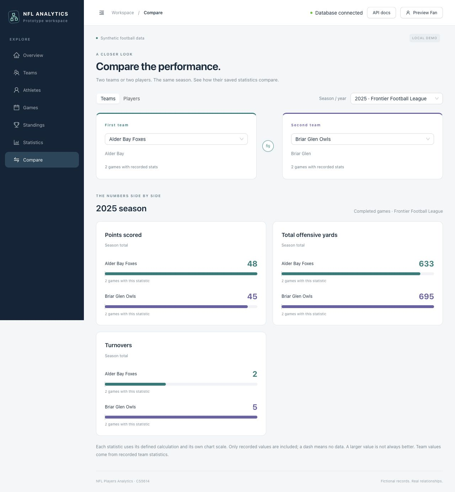

Table 44. Report 1 observed team aggregates

| Metric (sum)          | Alder Bay Foxes | Briar Glen Owls | Samples each |
| --------------------- | --------------- | --------------- | ------------ |
| Points scored         | 48.0            | 45.0            | 2            |
| Total offensive yards | 633.0           | 695.0           | 2            |
| Turnovers             | 2.0             | 5.0             | 2            |

## 5.2 Player Season Comparison

Report 2 asks how two rostered players compare in the same season. Choose Players, 2025, Alden Ashford, and Bennett Ashford. The service uses the same joined/grouped calculation as Listing 6 with athlete_id as the subject column, independently of list pagination. Player selectors come from complete season memberships and show team/position context. Team totals are not reconstructed by adding athlete rows.

Figure 16 and Table 45 show passing yards of 488 and 421, a difference of 67. Each side has two saved observations from two completed games. A missing metric is displayed as a dash rather than zero; values from mock live replays never contribute. The chart supports comparison, not a claim about professional player ability.

Figure 16. Report 2: 2025 player passing-yard comparison from saved completed games.

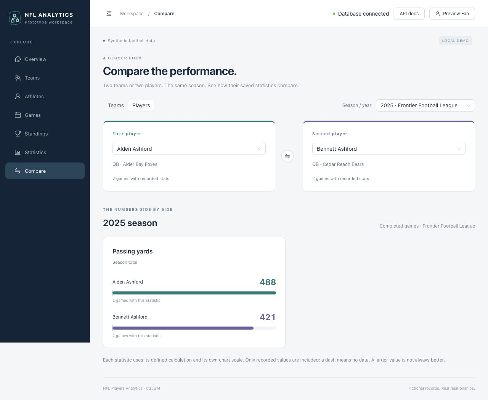

Table 45. Report 2 observed player aggregates

| Metric (sum)  | Alden Ashford | Bennett Ashford | Samples each |
| ------------- | ------------- | --------------- | ------------ |
| Passing yards | 488.0         | 421.0           | 2            |

Use GET /api/comparisons/options for valid selectors and GET /api/comparisons for the report. Both reports are read-only and unsaved. Invalid or repeated selections return 422.

# 6. GUI / Interface

Figure 17 shows the home page with named task links and a database-connected status. Navigation can collapse on any screen and expands to a full-screen menu on a phone. Pages include Teams, Players, Games, Statistics, Compare, Standings, and the admin workspace. Selection controls display names and context rather than asking users to type foreign-key IDs.

Figure 17. Home page with database connectivity and entry points to user tasks.

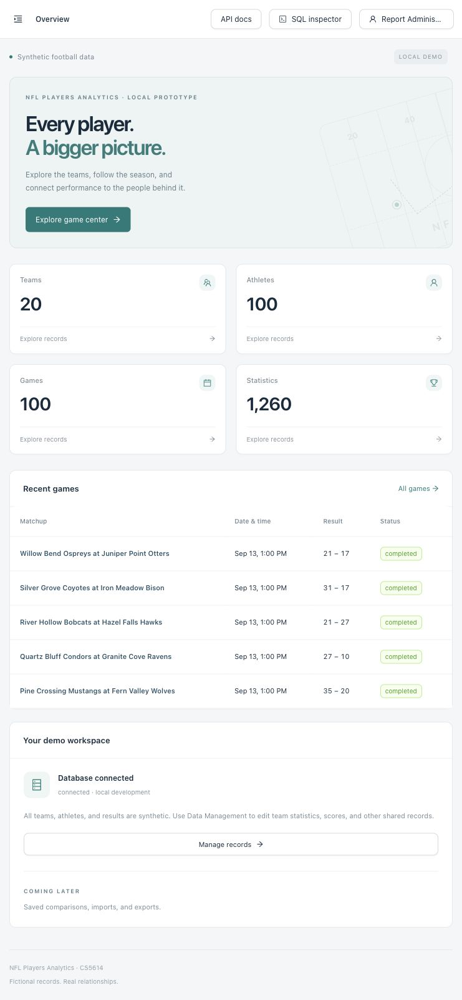

The Games page distinguishes a saved record from an explicitly scripted mock replay. Drive position, key events, and low-key impact explanations support exploration without writing simulated events into the database. Account favorites synchronize when devices use the same backend; separate local databases do not synchronize with one another.

### Season filters

Figure 18 shows a team roster filtered by the stored 2025 season. Rosters, memberships, and statistics follow that season together, while each section retains its own pagination. The filter includes a season ending in 2026; it does not reinterpret the selection as a calendar-year-only date search.

Figure 18. Team detail filtered by season, with readable player and roster labels.

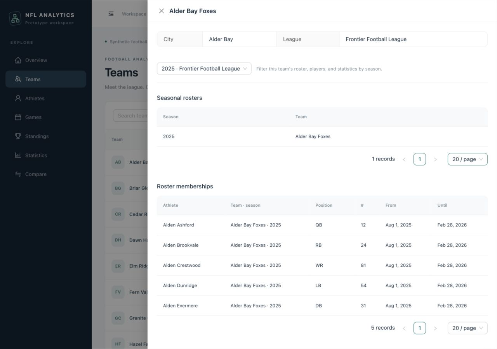

## 6.1 CRUD Operations

The following walkthrough uses a temporary synthetic team, Quarry Bay Comets, in the admin workspace. All four operations used the GUI and API in the disposable database. Figures 19–26 frame the relevant form/table region; original full captures remain in docs/screenshots/final-report/.

Figure 19 shows a search with no matching team before creation. Figure 20 shows the named league selector and completed add form. The relationship value submitted to the API is an ID selected from the database, even though the user sees Frontier Football League.

Figure 19. Create before: no Quarry Bay team exists.

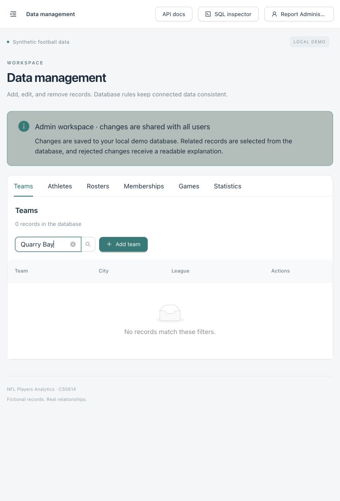

Figure 20. Create form: new team values and a database-backed league selection.

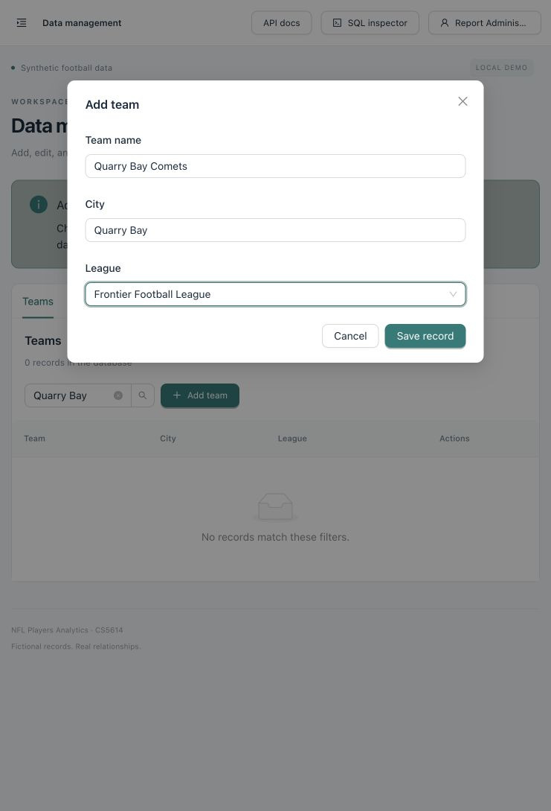

### Create result and update

Figure 21 confirms the saved team, with one matching record. Figure 22 shows the edit form loading its current values before changing the city from Quarry Bay to Quarry Heights. The update retains the team name and league.

Figure 21. Create after: Quarry Bay Comets is persisted and listed.

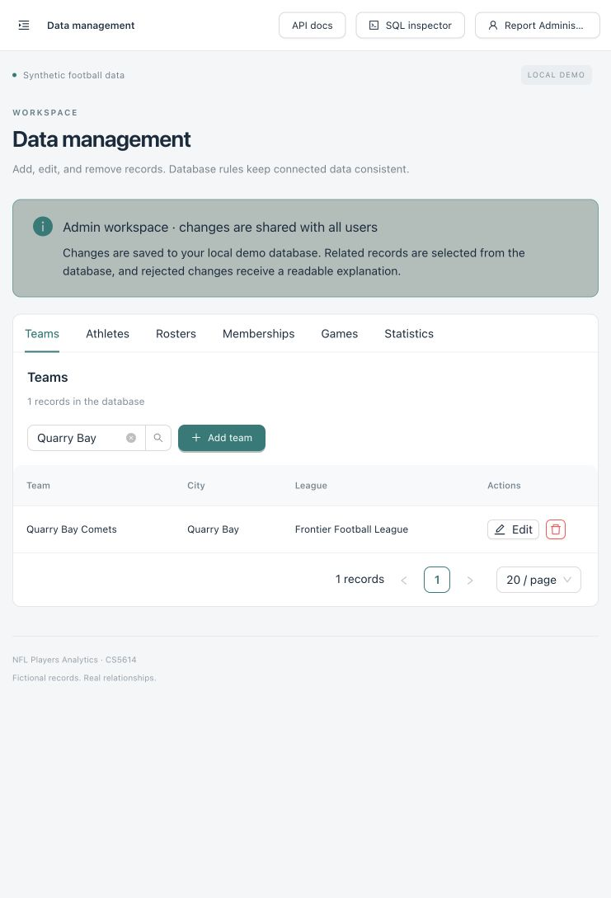

Figure 22. Update before: existing values are loaded into the form.

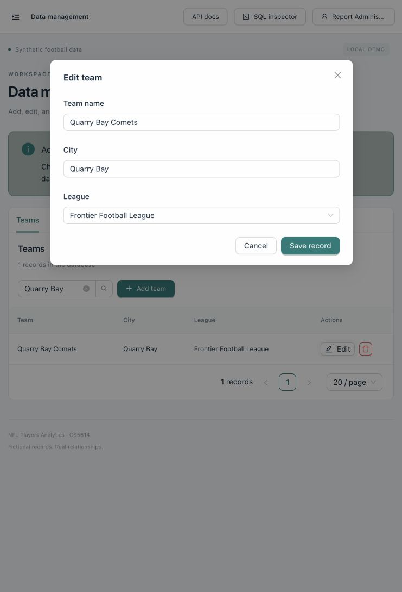

### Update result and delete confirmation

Figure 23 shows the changed city in the saved row. Figure 24 shows the confirmation before deletion. This newly created team has no roster or game children, so deletion can complete. A referenced team would be protected by RESTRICT and the backend would return a readable conflict.

Figure 23. Update after: the saved city is Quarry Heights.

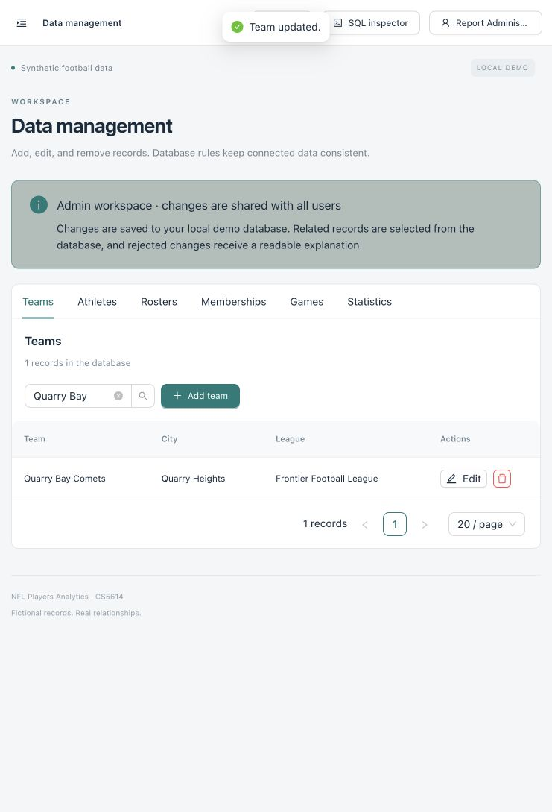

Figure 24. Delete before: confirmation explains that dependencies may block removal.

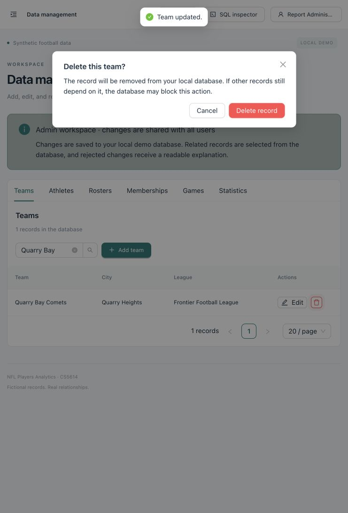

### Delete result and read search

Figure 25 shows no matching record after confirmation, completing the delete evidence. Figure 26 demonstrates Read/Search: filtering Teams by Alder returns the named team and league. These results demonstrate the observed operations, not exhaustive coverage of every entity.

Figure 25. Delete after: the Quarry Bay search returns zero records.

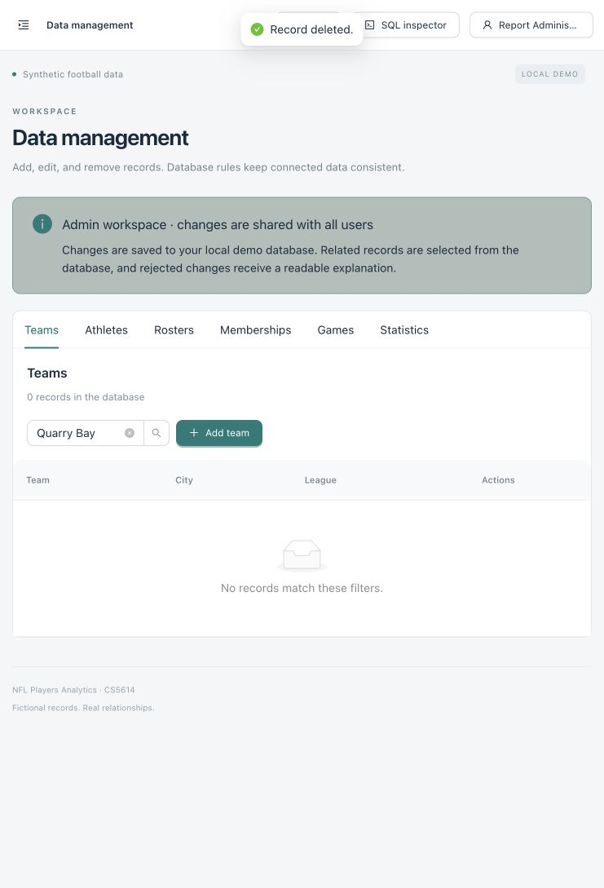

Figure 26. Read/Search: the team list is filtered by a meaningful name.

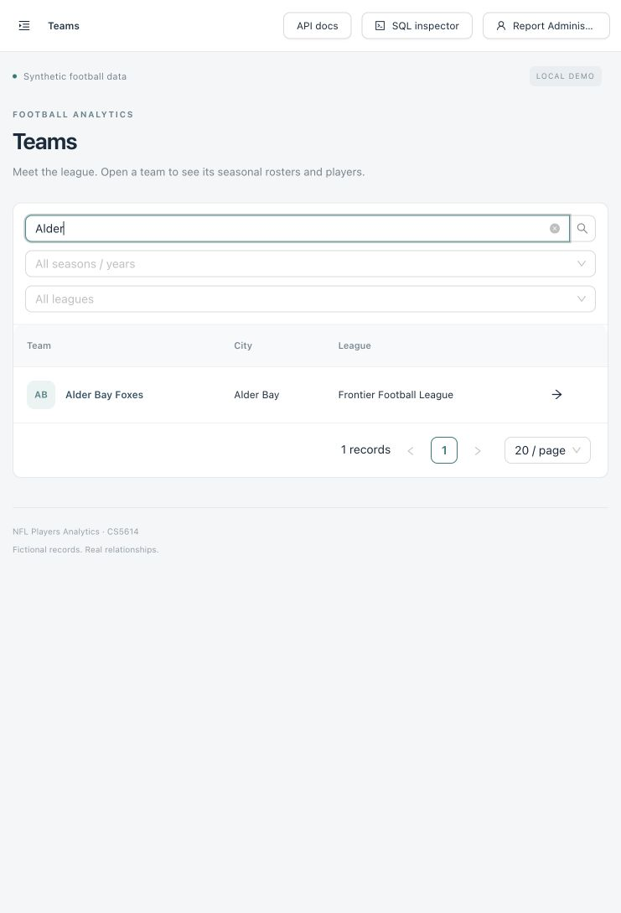

The browser receives {error: {code, message, fields?}} on rejection. Validation keeps current form input where practical, failed transactions roll back, successful writes refresh affected lists, and unavailable-backend/empty states are explicit. The optional admin SQL inspector shows actual emitted SQL and bound parameters; it cannot execute arbitrary SQL.

# 7. Reflection

## 7.1 Individual Contributions

The individual contribution paragraphs below are intentionally left blank at the team’s request. Each member should complete their paragraph before submission. No contribution has been inferred from Git author names or assigned by the assistant.

### John Zhao (techzjc@vt.edu)

### Ishaan Parikh (iparikh4@vt.edu)

### Victor Prosekov (vprosekov@vt.edu)

### AI-assisted work

Codex assisted with the prototype implementation and iterative refinements described in the project conversation, including component separation, readable formatting/CI, setup scripts, API documentation, the game-center UI, accounts and the request guard, comparisons, and season filters. For this report update, it implemented password change and admin user creation, performed targeted manual checks, captured screenshots in a disposable database, shortened README into linked guides, and prepared the schema/evidence documentation and report layout. This paragraph records assistance and does not replace the three members’ individual reflections or human review.

## 7.2 Team Reflection

A feature worth highlighting is the separation between simulated play and persisted statistical evidence. The game center can tell a visual story with a drive tracker and small-impact explanations, while comparison reports remain grounded in completed games stored in the relational model. Clear labels and separate code paths prevent a visually convincing mock score from contaminating the analytical results. This connects interface design to database correctness rather than treating them as separate concerns.

An alternative would have been to build only a generic table editor. Task-focused pages made the schema easier to use: the user chooses a team by name, filters a stored season, or compares two players without entering numeric references. Keeping database constraints and server validation underneath those forms was still necessary, because a friendly UI alone cannot protect data. The same lesson applied to the SQL-probe guard: parameter binding remains essential even when a suspicious request is blocked early.

The prototype has limits. It has no automated test suite, production migration history, email verification, password recovery, or distributed rate limiter. The normal seed and game visualizations cover one football league; extra report catalog fixtures do not add other sports workflows. Saved comparisons are not connected to accounts, and import/export workflows are deferred. Future work should add representative tests for authorization, session rotation, cross-table integrity, and report aggregation; introduce deliberate migrations; and evaluate another RDBMS with its driver and compatibility requirements. Changing DATABASE_URL alone is not a complete migration strategy.

# 8. Appendix

## 8.1 Repository and Deliverables

The public repository is the source for the application, reproducible setup, database scripts, and supporting report materials. Its public visibility was checked while preparing this report. The existing folder layout is retained; no files were moved merely to match an example hierarchy.

[Public project repository](https://github.com/g497813927/NFLPlayersAnalytics)

Table 46 maps deliverables to their actual locations. The editable Word report and PDF contain all three team names in author metadata. The original core schema was verified unchanged with SHA-256 d1653c7c2f2c42049b8182fc0c917c8f777de4a5b18be2b0515c2a6bdead2bc1.

Table 46. Repository evidence map

| Location                             | Content                                                                                                                   |
| ------------------------------------ | ------------------------------------------------------------------------------------------------------------------------- |
| README.md                            | Short project overview, screenshots, quick start, and guide links.                                                        |
| backend/ and frontend/               | API, SQLAlchemy mappings, React/TSX task screens, and dependency lockfiles.                                               |
| db/                                  | Unchanged core schema.sql plus auth_schema.sql.                                                                           |
| docs/SETUP.md and docs/USER_GUIDE.md | Detailed configuration, startup, task instructions, and limitations.                                                      |
| docs/final-report/                   | Final PDF/DOCX, evidence index, schema metadata, sample rows, query captures, UML diagrams, and this report in text form. |
| docs/screenshots/                    | Original screenshot captures, including the final-report walkthrough.                                                     |
| Section 7.1 of this report           | Reserved individual contribution paragraphs; intentionally blank.                                                         |

## 8.2 Evidence Method and Submission Notes

Evidence uses source baseline baf2c23a8291dfecc2d4cd73e93c14b05f1c8a25 plus the account-completion changes accompanying this report. A new disposable SQLite file was initialized using the SQL scripts and deterministic seed; the developer’s existing database was not reset. Browser captures show actual local application behavior. Team/player/roster screenshots from the preceding feature work were retained, and the two report result sets were rechecked through the current API. Figure captions identify form states rather than claiming an unobserved success.

The sample appendix is a read-only, sanitized snapshot. Credential hashes and session digests are withheld before publishing. Runtime verification consisted of the repository’s format/lint/build/Python-syntax checks and targeted manual browser/API checks. These are not an automated test suite or a complete security assessment. No CI or bot-review status is asserted in this static report; those statuses belong to the accompanying pull requests.

Before submission, the team should fill in each individual contribution paragraph, review the captured evidence, and submit the PDF and public repository link through one designated member. The two missing account features have been implemented; contribution text remains blank by instruction, rather than being invented.

## 8.3 References

The implementation files and captured evidence are the primary sources for project-specific claims. The following external references support the general security and SQLite explanations; accessed November 11, 2026.

[[1] OWASP SQL Injection Prevention Cheat Sheet](https://cheatsheetseries.owasp.org/cheatsheets/SQL_Injection_Prevention_Cheat_Sheet.html)

[[2] OWASP Password Storage Cheat Sheet](https://cheatsheetseries.owasp.org/cheatsheets/Password_Storage_Cheat_Sheet.html)

[[3] SQLite Foreign Key Support](https://www.sqlite.org/foreignkeys.html)
